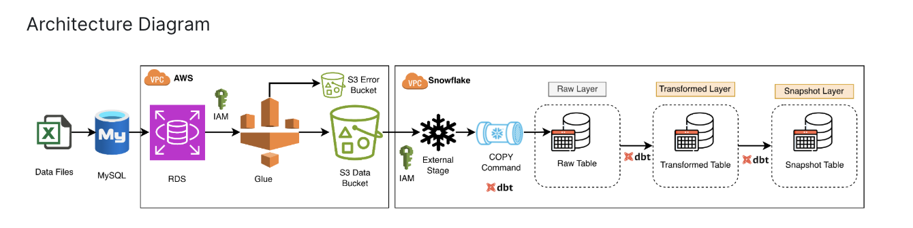

# Batch Processing with SCD Type 2 — AWS Glue · S3 · Snowflake · dbt

An end-to-end batch data pipeline that incrementally extracts product data from MySQL on Amazon RDS, validates it with AWS Glue, lands it in S3 as Parquet, loads it into Snowflake, and uses dbt to clean it and keep full history with **Slowly Changing Dimension (SCD) Type 2** snapshots.



## Architecture

```
MySQL (RDS) ──► AWS Glue (incremental extract + DQ checks)
                   ├── good rows ──► S3 data bucket  (Parquet)
                   └── bad rows  ──► S3 error bucket (Parquet + failure reasons)
S3 data bucket ──► Snowflake external stage ──► COPY INTO (dbt pre-hook)
   ──► RAW (Bronze) ──► TRANSFORMED (Silver) ──► SNAPSHOT (Gold, SCD2)
```

| Layer | Object | Built by | Purpose |
|---|---|---|---|
| Landing | `RAW.PRODUCT_CP` | `COPY INTO` (dbt macro) | Holds only the latest batch of files |
| Bronze | `RAW.PRODUCT_RAW` | dbt incremental (append) | Every extracted row, untransformed (VARIANT) |
| Silver | `TRANSFORMED.PRODUCT_TRANSFORMED` | dbt incremental (merge) | One cleaned, typed row per product |
| Gold | `SNAPSHOT.PRODUCT_SNAPSHOT` | dbt snapshot (`check`) | Full version history with `DBT_VALID_FROM` / `DBT_VALID_TO` |

## Tech stack

AWS (RDS MySQL, Glue Python Shell, S3, IAM, VPC) · Snowflake (storage integration, external stage, COPY) · dbt Cloud (models, tests, snapshots, scheduled job) · Python (pandas, pyarrow, pymysql)

## Key features

- **Incremental extraction** with an `updated_at` watermark stored in `s3://<data bucket>/checkpoint/product_checkpoint.json`
- **Data-quality gate in Glue**: negative price, negative quantity and NULL supplier rows go to the error bucket with a `dq_failure_reasons` column
- **Idempotent loading**: Snowflake COPY load history skips files already loaded
- **SCD Type 2** history with point-in-time queries
- **Automated schedule**: Glue workflow trigger, then a dbt Cloud job one hour later

## Repository layout

```
aws/
  glue/        Glue test + extract job scripts
  iam/         IAM trust and permission policies
  README.md    AWS resource inventory and S3 layout
mysql/         Source table DDL and test batches (full load, incremental, bad data, fixes)
snowflake/     Integration, stage, COPY table and validation queries
dbt/           dbt project: macros, models, snapshot
docs/          Architecture diagram
```

## Setup order

1. **S3** — create the data and error buckets.
2. **IAM** — Glue role (`aws/iam/glue_role_trust_policy.json`) and Snowflake role.
3. **VPC** — VPC, two subnets in different AZs, route table, IGW, security group (self-referencing All TCP + 3306 from your IP), S3 Gateway endpoint and Glue Interface endpoint.
4. **RDS MySQL** — DB subnet group, instance, database `dea`; run `mysql/01_create_product_table.sql`.
5. **Glue** — JDBC connection, the two Python Shell jobs (`--additional-python-modules pymysql`), workflow and scheduled trigger.
6. **Snowflake ↔ AWS** — run `snowflake/01_aws_integration.sql` Part A, put the `DESC INTEGRATION` values into `aws/iam/snowflake_role_trust_policy.json`, then Part B.
7. **Snowflake ↔ dbt** — key-pair auth (`snowflake/02_dbt_integration.sql`), dbt Cloud connection.
8. **Raw table** — `snowflake/03_product_cp_table.sql`.
9. **dbt** — deploy the `dbt/` project; create a Production environment and job (`dbt build`, scheduled after Glue).

## Running the test batches

For each batch: run the MySQL script → run the Glue extract job → run the dbt job → run `snowflake/04_validation_queries.sql`.

| After batch | Glue (good / bad) | PRODUCT_CP | PRODUCT_RAW | PRODUCT_TRANSFORMED | PRODUCT_SNAPSHOT |
|---|---|---|---|---|---|
| 1 — full load | 10 / 0 | 10 | 10 | 10 | 10 |
| 2 — incremental | 6 / 0 | 6 | 16 | 12 | 16 (4 closed) |
| 3 — incremental + bad data | 4 / 3 | 4 | 20 | 14 | 20 (6 closed) |

Product 3001 ends with three versions (5.99 → 6.49 → 6.99); products 4001, 4003 and 4007 appear only in the error bucket. `mysql/05_batch4_fix_bad_data.sql` fixes them at the source so they flow through on the next run.

## Notes

- Never re-run `CREATE OR REPLACE STORAGE INTEGRATION` - it issues a new external ID and breaks the AWS trust policy.
- Never full-refresh `product_raw` — `PRODUCT_CP` only holds the latest batch, so a rebuild would lose history.
- Hard deletes in MySQL are not captured (the extract is based on `updated_at`).
- Replace every `<PLACEHOLDER>` with your own values; keys and credentials are excluded via `.gitignore`.
